<div align="center">

# ShareOneList

**把你的 Microsoft 365 文件管明白的桌面应用**

[](https://github.com/ituff/ShareOneList/releases)
[](https://github.com/ituff/ShareOneList/releases)


[English](./README.md) | 简体中文

[📥 下载安装](#-下载安装) · [✨ 功能总览](#-核心功能) · [💬 反馈问题](https://github.com/ituff/ShareOneList/issues)

</div>

---

ShareOneList 是一款专注 Microsoft 365 的跨平台桌面文件管理器。**国际版组织账户、国际版个人账户、世纪互联（21Vianet）账户**三种 Microsoft 365 在同一个应用里并行使用；浏览 OneDrive 与 SharePoint 就像操作本地资源管理器；内置 **AI 助手**让云盘"开口回答"——提问时自动检索你的文件，基于文件内容作答；**Teams 会议录像**聚合播放、一键下载。

基于 Tauri 2 + Rust + React 构建：安装包小、启动快、内存占用低，配置与凭据全部保存在本机。

## ✨ 核心功能

### 🤖 AI 助手：直接问你的云盘

- 提问自动检索 OneDrive / SharePoint，读取 **docx / pptx / xlsx / pdf** 等文档内容后作答，回答附带**可点击的引用卡片**，来源可溯
- 接入任意 OpenAI 兼容供应商：内置 OpenAI、Azure OpenAI、DeepSeek、阿里百炼、Moonshot、智谱、Ollama 预设，支持连接测试和在线拉取模型列表
- 推理模型的思考过程实时展示，结束后自动折叠为一行，随时展开回看
- 聊天历史本地保存：重启不丢会话，多轮上下文完整保留
- **AI 记忆**：用 `#remember` / `#forget` 沉淀你的偏好与习惯，后续对话自动生效，回答中会披露引用了哪些记忆

### 🎬 Teams 会议录像与 AI 纪要

- 聚合散落在 OneDrive、SharePoint 站点和 Microsoft Search 中的会议录像
- 内置播放器直接播放，一键下载；下载被策略限制的录像可用**流式提取**保存为 MP4（详见 [Wiki](https://github.com/ituff/ShareOneList/wiki)）
- **AI 会议纪要**：录像预览页一键调用默认 LLM，基于会议转录生成结构化纪要（概述 / 讨论要点 / 决定 / 行动项 / 未解决问题），弹窗内流式实时显示，可一键导出 Word 文档（.docx）
- **下载会议脚本**：Teams 转录一键导出为 .txt 纯文本，他人共享的录像同样支持


### 🧩 云盘挂载为本地磁盘

- 通过内置本地 WebDAV 网关，把 OneDrive / SharePoint 文档库直接挂载为 **Windows 盘符或 macOS Finder 卷**——无需安装第三方驱动，挂载就在资源管理器 / Finder 里
- 挂载可读写：直接在资源管理器 / Finder 里拖入上传（大文件自动分块续传）、重命名、移动、删除（删除进 OneDrive 回收站），Office 可原地保存
- 多账号、多挂载点：范围可选我的 OneDrive / 站点文档库 / 子目录，可自定义网关路径名与（Windows）盘符；挂载在下次启动时自动恢复
- Windows 诊断与一键修复（WebClient 服务、Basic 认证策略、50 MB 单文件上限）；macOS 走系统 NetFS 接口，失败给出明确错误

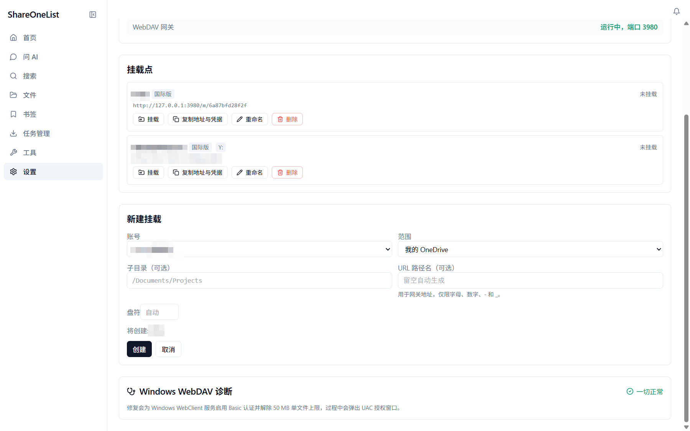

### ☁️ 三种 Microsoft 365，一个应用

- 国际版组织账户、国际版个人账户、世纪互联账户都是一等公民，各自提供合适的服务入口
- 多账户同时登录、并行浏览，可自定义别名和图标
- 世纪互联全流程适配：独立 OAuth 端点、Graph 端点、SharePoint 站点发现，与国际版会话完全隔离互不影响

### 🗺️ Drive Catalog 目录地图

- 跨站点、跨文档库的渐进式位置索引：随着浏览、搜索和使用 AI，它越来越知道你的文件在哪
- 让全局搜索和 AI 回答能直接命中 SharePoint 文档库深处的文件

### 🚀 为大文件而生的下载引擎

- 断点续传：下载中断、重启应用后都能接着下，失败批次从分块进度直接恢复
- 可校验的完整性：文件先落 `.tmp` 临时名（不被 OneDrive 同步客户端扫描），通过大小 + QuickXorHash 校验后才落正式名；**校验文件**按钮对已完成的批量任务逐文件比对云端，一键重新下载异常文件
- 逐文件真实错误信息，瞬时错误自动重试，右下角常驻进度胶囊随时回来看
- 批量下载：一次选中多个文件，归并为一个任务，进度与速度一目了然
- 国内加速：下载失败自动回退多个加速镜像，流式写入磁盘 + 实时进度

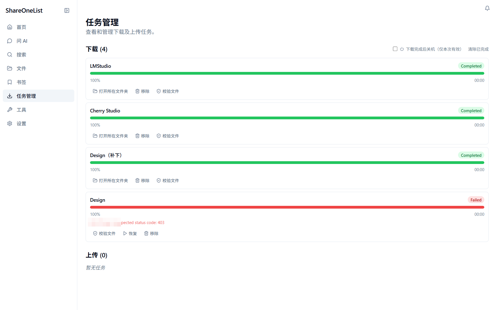

### 🔄 配置备份与恢复

- 一键导出 / 导入配置备份：包含全部设置与账户信息，换机、重装一步恢复
- 备份内容可勾选：登录凭据、AI 供应商配置与 Key、聊天记录与记忆、Drive Catalog、WebDAV 挂载、下载任务列表——含密钥的部分使用你设置的备份密码做 AES-256-GCM 加密
- 自动备份：选择一个账户及其 OneDrive 中的文件夹，设置或账户变更后自动上传最新备份；仅当勾选了聊天记录或目录地图且内容有变化时，启动/退出时才会额外备份

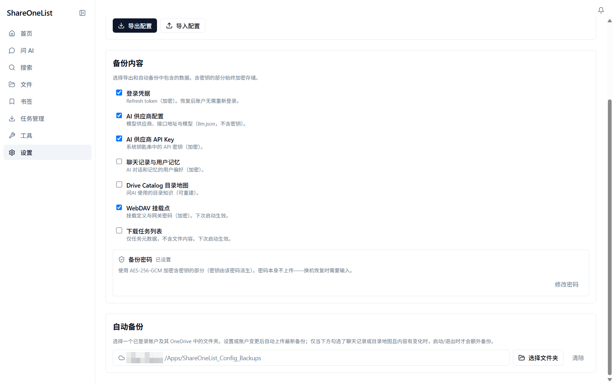

### 📌 托盘常驻与后台运行

- 可选**关闭窗口时驻留托盘**：关窗后云盘挂载与后台任务保持在线，从托盘图标重新打开或退出（退出前自动断开全部挂载）
- 退出保护：有挂载在使用时关应用会先询问——驻留托盘或断开全部挂载后退出；任务栏「关闭窗口」无法绕过提醒
- 可选开机自启动，均在 **设置 → 通用**

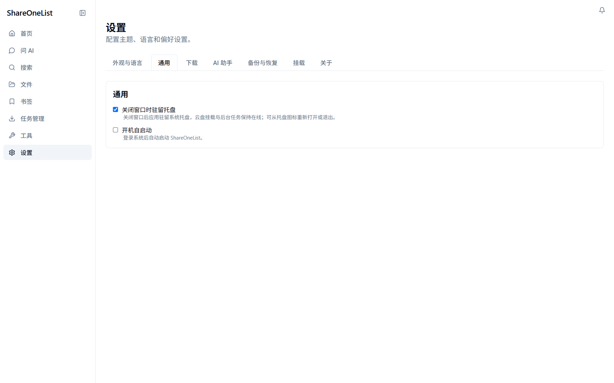

### 还有这些

- 🔍 全局搜索：跨账户搜索，按来源账户、文件类型、修改日期筛选
- 👁 在线预览：图片、视频、Markdown、Office 文档，支持图片 / 视频缩略图
- 🗂 文件管理：书签、分享链接、重命名、删除、属性、转 PDF、存储容量显示
- 🖼 详细 / 缩略图 / 看图三种布局，拖拽上传，列头点击排序，长路径面包屑自动折叠
- 🔔 通知中心 + 应用内检查更新，正式版 / 测试版双更新通道
- 🌗 深色 / 浅色主题；English / 简体中文 / 日本語 / Deutsch 四种界面语言

## 📥 下载安装

从 [Releases](https://github.com/ituff/ShareOneList/releases) 下载对应平台的安装包：

| 平台 | 安装包 |
|---|---|
| Windows 10/11 x64 | `.exe` 安装包 / `.msi` |
| Windows 10/11 arm64 | `.exe` 安装包 / `.msi` / 绿色版 `.zip` |
| macOS (Apple Silicon) | `.dmg` |

> 想第一时间尝鲜新功能？在 **设置 → 关于** 中把更新渠道切换为"测试版"，即可收到预发布版本推送。

<details>
<summary><b>macOS 首次打开提示"无法验证开发者"？</b></summary>

dmg 内已附带修复脚本 `fix-macos-gatekeeper.command` 和中英文说明——挂载 dmg 后双击脚本即可（若仍提示，右键 → 打开）。也可以手动执行：

```bash
xattr -cr /Applications/ShareOneList.app
open /Applications/ShareOneList.app
```

如果提示权限不足，请使用 `sudo xattr -cr /Applications/ShareOneList.app`。辅助脚本见 [scripts/fix-macos-gatekeeper.command](./scripts/fix-macos-gatekeeper.command)。

</details>

## 🚀 快速上手

1. 安装并启动 ShareOneList
2. 进入 **文件** 页，点击 **添加网盘**，登录你的 Microsoft 账户（可添加多个不同环境的账户）
3. 双击网盘开始浏览；也可以在首页直接 **搜索** 或 **问 AI**

## 📸 截图

| 首页 | 云盘 |
|---|---|
| 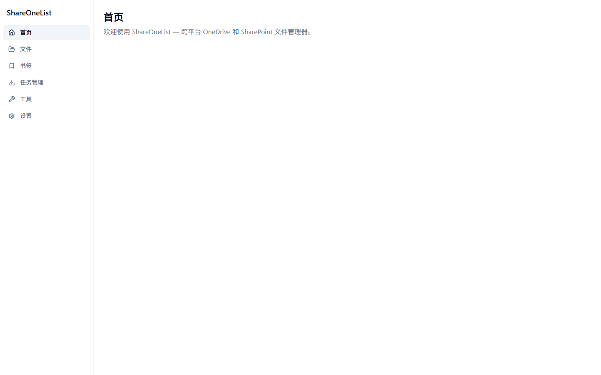 | 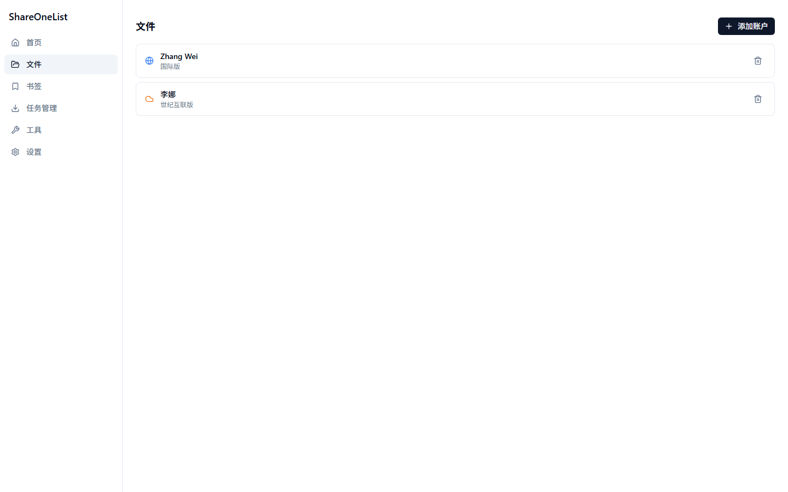 |
| **网盘中心** | **文件浏览** |
| 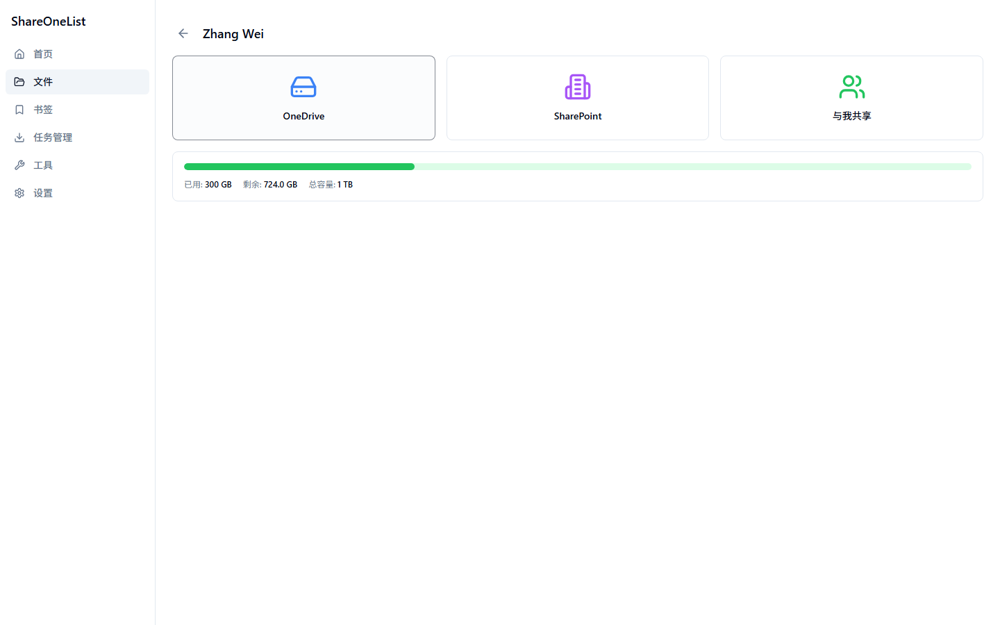 | 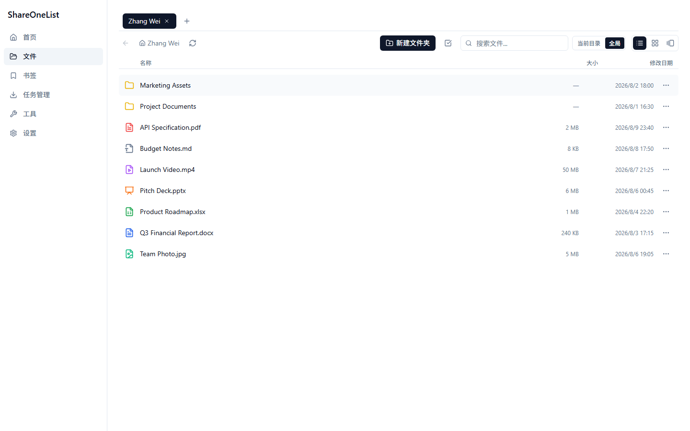 |
| **网格布局** | **任务管理** |
| 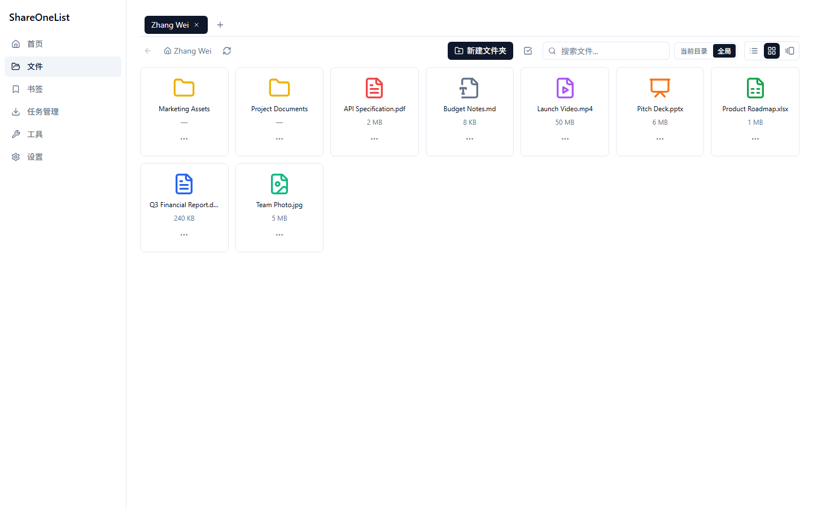 |  |
| **书签** | **工具** |
| 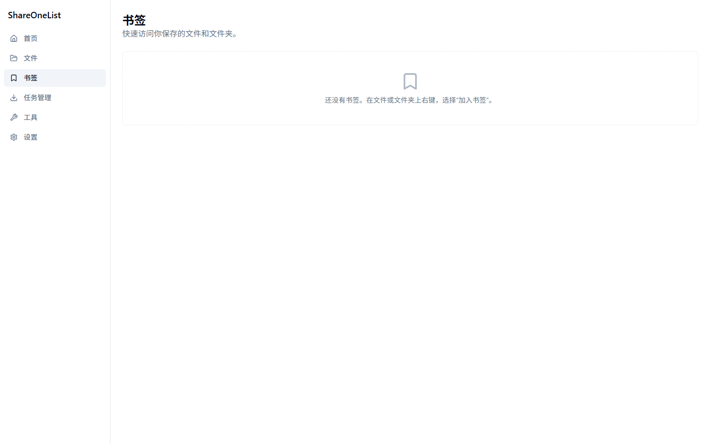 | 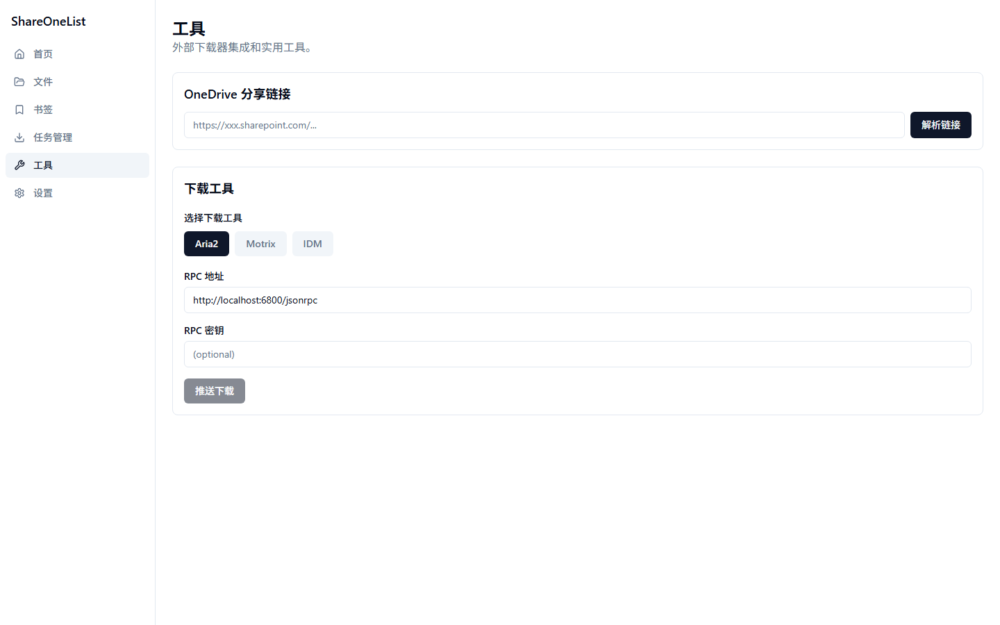 |
| **设置** | **深色模式** |
| 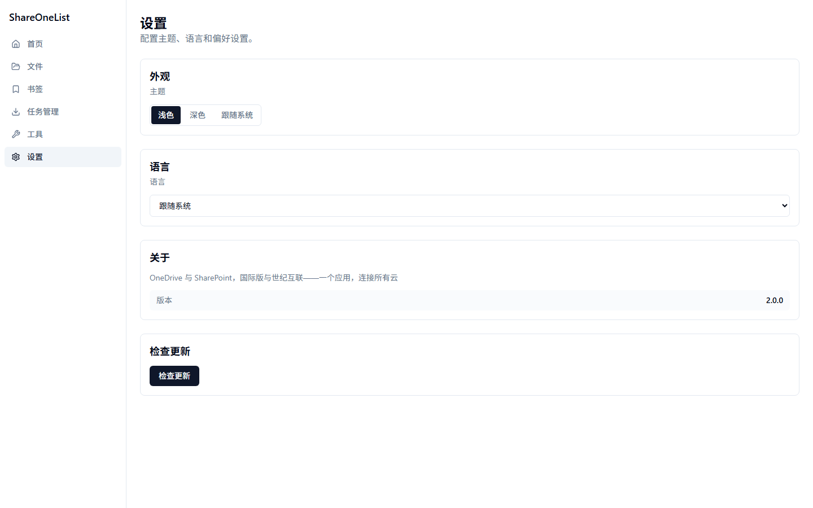 | 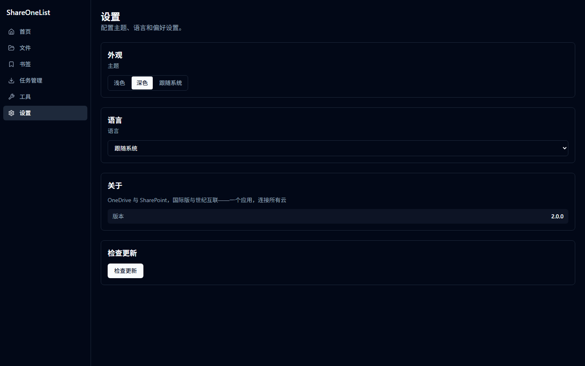 |

## 🏢 企业管理员

在企业内批量部署 ShareOneList？Wiki 提供分云的**管理员部署指南**，覆盖租户级管理员同意（一条 URL 完成）、用户同意策略受限的处理、网络端点白名单：

- [国际版](https://github.com/ituff/ShareOneList/wiki/管理员部署指南-国际版) · [English](https://github.com/ituff/ShareOneList/wiki/Admin-Deployment-Guide-Global)
- [世纪互联版](https://github.com/ituff/ShareOneList/wiki/管理员部署指南-世纪互联版) · [English](https://github.com/ituff/ShareOneList/wiki/Admin-Deployment-Guide-21Vianet)

应用仅使用 Microsoft Graph 委托权限，严格以登录用户身份操作——不申请应用权限、无后台独立访问；令牌只保存在本机系统凭据库。

## ⚙️ 高级配置

应用内置国际版和世纪互联版的 Azure AD 客户端 ID，开箱即用。如需使用自己的 Azure AD 应用，请在 [portal.azure.com](https://portal.azure.com)（国际版）和 [portal.azure.cn](https://portal.azure.cn)（世纪互联版）分别注册，并在应用内配置。

## 🛠️ 从源码构建

```bash
git clone https://github.com/ituff/ShareOneList.git
cd ShareOneList/tauri-app
npm install
npm run tauri dev
```

欢迎通过 [Issues](https://github.com/ituff/ShareOneList/issues) 反馈问题或建议。
